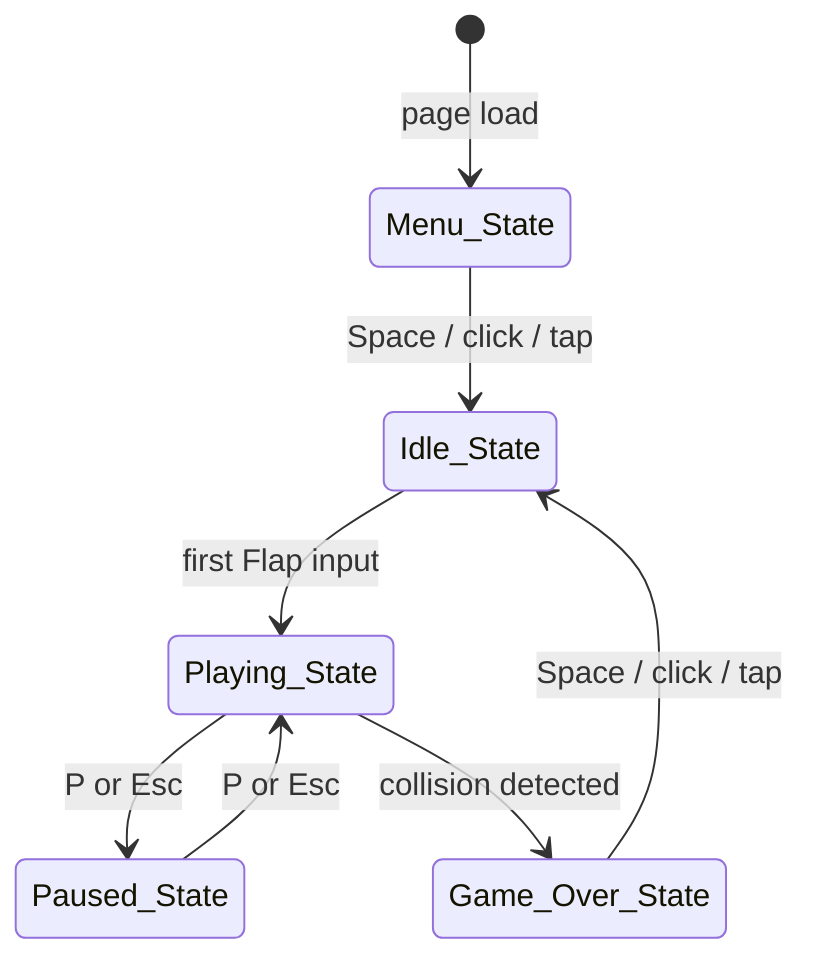

# Design Document — Flappy Kiro

## Overview

Flappy Kiro is a self-contained, browser-based endless scroller game delivered as three static files: `index.html`, `game.js`, and `style.css`. No build toolchain, no framework, no backend is required. All game logic runs inside a single `<canvas>` element driven by `requestAnimationFrame`.

The design centres on a **finite state machine** that owns all transitions between the five named states (Menu → Idle → Playing → Paused → Game Over), a **layered renderer** that draws each frame top-to-bottom, and a set of lightweight manager objects (InputManager, PhysicsEngine, AudioManager, ScoreManager) that are all orchestrated by a central **GameLoop**.

Key design goals:
- Physics stays frame-rate-independent via delta-time scaling.
- All game-element sizes are expressed as logical pixels and recomputed on every canvas resize.
- The object pool for pipes keeps memory allocation off the hot path.
- All external side-effects (localStorage, AudioContext, DOM events) are isolated in dedicated managers to keep core logic pure and testable.

---

## Architecture

### File Layout

```
index.html      — single HTML page; hosts <canvas id="gameCanvas">
style.css       — centres canvas, full-viewport background colour
game.js         — ES module; all game logic; imported by index.html
assets/
  ghosty.png
  jump.wav
  game_over.wav
```

### High-Level Component Diagram

```
┌─────────────────────────────────────────────────────────────┐
│                         game.js                             │
│                                                             │
│  ┌─────────────┐    tick(dt)    ┌──────────────────────┐   │
│  │  GameLoop   │───────────────▶│  GameStateManager    │   │
│  │ (rAF-driven)│                │  (state machine)     │   │
│  └─────────────┘                └──────┬───────────────┘   │
│         ▲                              │ reads/writes       │
│         │ events                       ▼                    │
│  ┌──────┴──────┐             ┌─────────────────────┐       │
│  │InputManager │             │    GameState         │       │
│  │(kbd/click/  │             │  { ghost, pipes[],  │       │
│  │ touch)      │             │    clouds[], score,  │       │
│  └─────────────┘             │    highScore, …}     │       │
│                              └────┬────────────────┘       │
│                      ┌────────────┼────────────┐           │
│                      ▼            ▼            ▼           │
│              ┌──────────┐ ┌──────────┐ ┌──────────┐       │
│              │ Physics  │ │ Score    │ │  Audio   │       │
│              │ Engine   │ │ Manager  │ │  Manager │       │
│              └──────────┘ └──────────┘ └──────────┘       │
│                      │                                      │
│                      ▼                                      │
│              ┌──────────────────────────────────┐          │
│              │           Renderer               │          │
│              │  Background → Clouds → Pipes     │          │
│              │  → Ghost → HUD → Overlay         │          │
│              └──────────────────────────────────┘          │
└─────────────────────────────────────────────────────────────┘
```

### State Transition Diagram



### Data Flow

1. **Input events** arrive at `InputManager`, which maps raw DOM events to semantic actions (`FLAP`, `PAUSE_TOGGLE`, `RESTART`).
2. Actions are dispatched to `GameStateManager.handleAction(action)`.
3. `GameStateManager` decides, based on the current state, what to do with each action and updates `GameState` accordingly.
4. On each `requestAnimationFrame` callback, `GameLoop` computes `deltaMs`, then calls:
   - `GameStateManager.tick(deltaMs)` — advances physics, pipe positions, score, cloud positions.
   - `Renderer.draw(gameState, canvas, ctx)` — renders the current frame.
5. `PhysicsEngine` functions are pure: they take a ghost/pipe/cloud object plus `dtFactor` and return an updated object. `GameStateManager` applies those results to `GameState`.
6. `ScoreManager` watches pipe positions each tick and increments `gameState.score` when a crossing occurs. It calls `AudioManager` and persists to `localStorage` on high-score update.
7. `AudioManager` wraps the Web Audio API; all sound calls go through it so `AudioContext` lifecycle is managed in one place.

---

## Components and Interfaces

### GameLoop

```js
class GameLoop {
  start()                     // calls requestAnimationFrame, starts loop
  stop()                      // cancels pending rAF
  _tick(timestampMs)          // internal: computes dt, delegates to GameStateManager + Renderer
}
```

`dtFactor = deltaMs / 16.667` normalises delta-time so that physics constants are expressed at a 60 fps baseline.

### GameStateManager

```js
class GameStateManager {
  constructor(gameState, physicsEngine, scoreManager, audioManager)
  handleAction(action)        // 'FLAP' | 'PAUSE_TOGGLE' | 'RESTART'
  tick(deltaMs)               // advances simulation one frame
  _transitionTo(newState)     // handles enter/exit side-effects for each state
}
```

Owns all state-transition logic. Side-effects on transition:
- → `Idle_State`: reset score, ghost, pipes, pipe speed.
- → `Playing_State` (from Idle): apply first flap impulse.
- → `Game_Over_State`: freeze, play `game_over.wav`, update/persist high score.
- → `Paused_State`: freeze; do nothing else.

### PhysicsEngine

All functions are **pure** — no side effects, easy to unit-test.

```js
const PhysicsEngine = {
  applyGravity(ghost, dtFactor)     // returns updated ghost with new vy
  applyFlap(ghost)                  // returns ghost with vy = −8
  clampVelocity(ghost)              // returns ghost with vy clamped to [−∞, 12]
  updatePosition(ghost, dtFactor)   // returns ghost with new y = y + vy * dtFactor
  computeRotation(vy)               // maps vy ∈ [−8, 12] → angle ∈ [−25°, 90°]
  bobOffset(timeMs)                 // sinusoidal idle bob: 10 * sin(2π * t / 2000)
}
```

### InputManager

```js
class InputManager {
  constructor(canvas, onAction)     // onAction: (action) => void
  attach()                          // registers DOM event listeners
  detach()                          // removes DOM event listeners
  _onKeyDown(e)                     // Space → FLAP; P/Esc → PAUSE_TOGGLE
  _onClick()                        // → FLAP (with debounce)
  _onTouchStart(e)                  // e.preventDefault(); → FLAP (with debounce)
}
```

Debounce: tracks `lastFlapTime`; ignores FLAP actions within 100 ms of the previous one.

### Renderer

```js
const Renderer = {
  draw(gameState, canvas, ctx)      // full-frame draw, in layer order
  _drawBackground(ctx, canvas)
  _drawClouds(ctx, clouds)
  _drawPipes(ctx, pipes, canvas)
  _drawGhost(ctx, ghost, sprite)
  _drawHUD(ctx, score, highScore, canvas)
  _drawMenuOverlay(ctx, highScore, canvas)
  _drawPausedOverlay(ctx, canvas)
  _drawGameOverOverlay(ctx, score, highScore, isNewBest, canvas)
}
```

Draw order is strictly: Background → Clouds → Pipes → Ghost → HUD → Overlay (when applicable).

Ghost rotation uses `ctx.save() / ctx.translate(cx, cy) / ctx.rotate(rad) / ctx.drawImage(...) / ctx.restore()`.

### AudioManager

```js
class AudioManager {
  constructor()
  async init()                      // creates AudioContext, loads buffers
  resumeIfSuspended()               // called on first user interaction
  playJump()
  playGameOver()
}
```

Sounds are decoded once into `AudioBuffer` objects and replayed via `AudioBufferSourceNode` on each call.

`playJump()` checks whether the ghost's current `vy` equals `−8` (already at the flap ceiling) before playing — if so, it skips playback. This check is delegated to the caller (`GameStateManager`) which passes a `shouldPlaySound` flag to keep `AudioManager` free of game-logic dependencies.

### ScoreManager

```js
const ScoreManager = {
  checkScoring(ghost, pipes, state)   // mutates state.score; returns pipes[] with .scored flags set
  onGameOver(state)                   // updates highScore, persists to localStorage
  loadHighScore()                     // reads localStorage; returns number (0 if absent)
  saveHighScore(value)                // writes localStorage
}
```

### CanvasScaler

```js
const CanvasScaler = {
  resize(canvas, containerWidth)   // sets canvas.width/height, returns { scale, w, h }
  toLogical(canvasCoord, scale)     // converts canvas pixels back to logical pixels
}
```

Maximum canvas width: 1280 px. Aspect ratio: 4:3. All game constants are defined in logical pixels at 480×360 base resolution; `scale` is applied during rendering.

---

## Data Models

### Ghost

```js
const createGhost = () => ({
  x: 80,             // logical px — fixed horizontal position
  y: 180,            // logical px — vertical position (top edge)
  vy: 0,             // vertical velocity, px/tick at 60fps baseline
  rotation: 0,       // radians
  width: 32,         // logical px (sprite draw size)
  height: 32,
  sprite: null,      // HTMLImageElement loaded at init
})
```

Hitbox (for collision): `{ x: ghost.x + 4, y: ghost.y + 4, w: 24, h: 24 }` (4 px inward margin on all sides).

### Pipe

```js
const createPipe = (x, gapCentreY, canvasH) => ({
  x,                 // logical px — left edge of pipe body
  gapCentreY,        // logical px — vertical centre of the gap
  gapHeight: 150,    // logical px — constant
  bodyWidth: 52,     // logical px
  capWidth: 64,      // logical px
  capHeight: 16,     // logical px
  scored: false,     // true once ghost has crossed this pipe's centre
})
```

Top pipe extends from `y = 0` down to `y = gapCentreY − gapHeight / 2`.
Bottom pipe extends from `y = gapCentreY + gapHeight / 2` up to `y = canvasH`.
Cap is drawn at the mouth of each pipe section.

### Cloud

```js
const createCloud = (x, y, width, height) => ({
  x,                 // logical px
  y,                 // logical px — within top 60% of canvas
  width,             // logical px — randomised per cloud
  height,            // logical px — randomised per cloud
  speed: 0.5,        // logical px/tick — clouds scroll slower than pipes (parallax)
})
```

### GameState

```js
const createGameState = () => ({
  current: 'Menu_State',   // one of the five named states
  score: 0,
  highScore: 0,            // loaded from localStorage at init
  ghost: createGhost(),
  pipes: [],               // array of Pipe objects, max 6
  clouds: [],              // array of Cloud objects, 3–6
  pipeSpeed: 3,            // px/tick at 60fps baseline
  pipesSinceSpeedUp: 0,    // count of pipes passed since last speed increase
  idleTimeMs: 0,           // elapsed ms in Idle_State, used for sinusoidal bob
  lastPipeX: null,         // x of last spawned pipe's leading edge, for spacing check
})
```

### Entity Relationship Summary

```
GameState
  ├── Ghost (1)
  ├── Pipe[] (0..6)
  └── Cloud[] (3..6)
```

---

## Correctness Properties

*A property is a characteristic or behavior that should hold true across all valid executions of a system — essentially, a formal statement about what the system should do. Properties serve as the bridge between human-readable specifications and machine-verifiable correctness guarantees.*

### Property 1: Canvas aspect ratio invariant

*For any* browser viewport width W, the canvas dimensions computed by `CanvasScaler.resize` shall satisfy `canvasWidth = min(W, 1280)` and `canvasHeight = canvasWidth × 0.75`.

**Validates: Requirements 1.5, 1.6**

---

### Property 2: Ghost rotation after flap is within bounds

*For any* ghost state (any current `vy`), applying a flap via `PhysicsEngine.applyFlap` followed by `PhysicsEngine.computeRotation` shall produce a rotation angle in the range [−30°, −20°].

**Validates: Requirements 2.6**

---

### Property 3: Ghost rotation while falling never exceeds +90°

*For any* downward velocity `vy` in [0, 12], `PhysicsEngine.computeRotation(vy)` shall return an angle in [0°, 90°], and the mapping shall be non-decreasing as `vy` increases.

**Validates: Requirements 2.7**

---

### Property 4: Gravity accumulates correctly with delta-time

*For any* ghost with initial vertical velocity `vy0` and any `dtFactor > 0`, after one physics tick `ghost.vy = clamp(vy0 + 0.5 × dtFactor, −∞, 12)`.

**Validates: Requirements 3.1, 3.3**

---

### Property 5: Flap always sets vy to exactly −8

*For any* ghost state (any `vy`), applying `PhysicsEngine.applyFlap` shall set `ghost.vy` to exactly −8.

**Validates: Requirements 3.2**

---

### Property 6: Position update scales linearly with delta-time

*For any* ghost with velocity `vy` and any `dtFactor > 0`, `PhysicsEngine.updatePosition` shall produce `ghost.y_new = ghost.y + vy × dtFactor`.

**Validates: Requirements 3.5**

---

### Property 7: Ghost idle bob stays within amplitude bounds

*For any* elapsed time `t`, `PhysicsEngine.bobOffset(t)` shall return a value in [−20, 20] px and the waveform shall be sinusoidal with period in [1000 ms, 3000 ms].

**Validates: Requirements 3.7**

---

### Property 8: Pipe dimensions are always exact

*For any* pipe object produced by `createPipe`, `pipe.bodyWidth = 52`, `pipe.capWidth = 64`, `pipe.capHeight = 16`, and `pipe.gapHeight = 150`.

**Validates: Requirements 4.1, 4.5**

---

### Property 9: Gap centre is always within safe bounds

*For any* generated pipe on a canvas of height `H`, `pipe.gapCentreY ∈ [150, H − 150]`, ensuring both pipe caps remain fully visible.

**Validates: Requirements 4.4**

---

### Property 10: Active pipe count never exceeds 6

*For any* sequence of game update ticks in Playing_State, the length of `gameState.pipes` shall never exceed 6.

**Validates: Requirements 4.8**

---

### Property 11: Pipe scroll speed increases at multiples of 5 and is capped at 6

*For any* pipe pass count N that is a multiple of 5, `pipeSpeed` after the N-th pipe shall equal `min(3 + floor(N/5) × 0.3, 6)`.

**Validates: Requirements 4.6**

---

### Property 12: Collision detection uses 4 px inward hitbox margin

*For any* ghost position and pipe position, the AABB overlap check shall use a ghost hitbox shrunk by exactly 4 px inward on all sides (i.e., `hitbox = { x: ghost.x+4, y: ghost.y+4, w: ghost.w−8, h: ghost.h−8 }`).

**Validates: Requirements 5.4, 5.1**

---

### Property 13: Boundary collision detected at correct edges

*For any* ghost position where `ghost.y < 0` (top boundary) or `ghost.y + ghost.height ≥ hudTop` (bottom boundary), `CollisionDetector.checkBoundary` shall return `true`.

**Validates: Requirements 5.2, 5.3**

---

### Property 14: Score increments exactly once per pipe crossing

*For any* pipe that transitions from `ghost.cx < pipe.cx` to `ghost.cx ≥ pipe.cx`, the score shall increment by exactly 1, and `pipe.scored` shall be set to `true` preventing any further increments for that pipe.

**Validates: Requirements 6.1**

---

### Property 15: High score is always the maximum of all session scores

*For any* session score `S` and stored high score `H`, after `ScoreManager.onGameOver` the persisted high score shall equal `max(S, H)`.

**Validates: Requirements 6.3, 6.4**

---

### Property 16: High score round-trip through localStorage

*For any* high score value `V` written by `ScoreManager.saveHighScore(V)`, a subsequent call to `ScoreManager.loadHighScore()` shall return `V`. When no value is stored, `loadHighScore()` shall return `0`.

**Validates: Requirements 6.5**

---

### Property 17: Game over overlay always contains score and high score

*For any* final score `S` and high score `H`, the string produced by the game-over overlay renderer shall contain both the string representation of `S` and of `H`.

**Validates: Requirements 7.3**

---

### Property 18: "New Best!" shown if and only if score exceeds previous high score

*For any* final score `S` and previous high score `H`, the game-over overlay shall contain "New Best!" if and only if `S > H`.

**Validates: Requirements 7.4**

---

### Property 19: Restart produces a clean Idle_State regardless of prior game state

*For any* `Game_Over_State` configuration (arbitrary score, pipe positions, ghost position), applying a RESTART action shall produce: `score = 0`, `ghost` at starting position, `pipes = []`, `pipeSpeed = 3`, and `current = 'Idle_State'`.

**Validates: Requirements 7.6**

---

### Property 20: Pause/resume is a state round-trip that preserves all positions

*For any* `Playing_State` configuration (any ghost `y`/`vy`, any pipe `x` positions, any score), transitioning to `Paused_State` and back to `Playing_State` shall leave all values unchanged.

**Validates: Requirements 11.3, 11.5**

---

### Property 21: Flap inputs are ignored while paused

*For any* ghost state while in `Paused_State`, dispatching a FLAP action shall leave `ghost.vy` and `ghost.y` unchanged.

**Validates: Requirements 11.4**

---

### Property 22: Input debounce rejects rapid flap inputs

*For any* pair of FLAP events where `t2 − t1 < 100 ms`, the second event shall not trigger a flap impulse on the ghost.

**Validates: Requirements 9.4**

---

## Error Handling

### Asset Loading Failures (Requirement 1.3)

Each asset is loaded with an `onerror` handler. On failure:
- **Ghost sprite**: `ghost.sprite` is set to `null`; the renderer draws a white filled circle of radius 16 px at the ghost's position instead of `drawImage`.
- **jump.wav / game_over.wav**: the corresponding `AudioBuffer` is set to `null`; `AudioManager.playJump()` / `playGameOver()` no-ops silently.

The game loop is started regardless of asset load success; the `assets.loaded` counter reaching `TOTAL_ASSETS` is not a gate.

### AudioContext Suspension

Browsers require a user gesture before an `AudioContext` can produce sound. `AudioManager.resumeIfSuspended()` is called on the first FLAP, PAUSE_TOGGLE, or RESTART action. If the context is still suspended, sound is not played for that interaction — this is acceptable and documented.

### Canvas Resize During Gameplay

`window.resize` fires `CanvasScaler.resize`, which updates `canvas.width/height` and recomputes `scale`. Pipe and ghost logical coordinates are unchanged; only their rendered pixel size changes. If the game is in Playing_State when a resize happens, the next tick continues normally.

### localStorage Unavailability

`ScoreManager.saveHighScore` / `loadHighScore` wrap all `localStorage` calls in a `try/catch`. On failure (private mode, storage full), the high score is maintained in memory only for the current session.

### Invalid Frame Times

If `deltaMs` from `requestAnimationFrame` exceeds 200 ms (e.g., tab was backgrounded), `GameLoop` clamps it to 50 ms before computing `dtFactor` to prevent physics tunnelling.

---

## Testing Strategy

### Property-Based Testing

The project targets **browser-native JavaScript**, so the recommended PBT library is [**fast-check**](https://fast-check.dev/) (works in browser and Node.js without a build step via CDN or script tag for tests).

Each property test is tagged with a comment referencing its design property:
```js
// Feature: flappy-kiro, Property 4: Gravity accumulates correctly with delta-time
```

Minimum **100 iterations** per property test. Tests run against pure functions extracted from `game.js` (PhysicsEngine, ScoreManager, CanvasScaler, CollisionDetector).

**PBT targets (pure functions only):**

| Property | Function Under Test |
|----------|-------------------|
| 1 — Canvas aspect ratio | `CanvasScaler.resize` |
| 2 — Ghost rotation after flap | `PhysicsEngine.applyFlap` + `computeRotation` |
| 3 — Rotation ≤ 90° while falling | `PhysicsEngine.computeRotation` |
| 4 — Gravity with delta-time | `PhysicsEngine.applyGravity` |
| 5 — Flap sets vy = −8 | `PhysicsEngine.applyFlap` |
| 6 — Position update scales with dt | `PhysicsEngine.updatePosition` |
| 7 — Bob stays in amplitude bounds | `PhysicsEngine.bobOffset` |
| 8 — Pipe dimensions exact | `createPipe` |
| 9 — Gap centre in safe bounds | `createPipe` |
| 10 — Active pipe count ≤ 6 | `PipeManager.update` |
| 11 — Speed increase at multiples of 5 | `PipeManager.computeSpeed` |
| 12 — Hitbox 4 px inward margin | `CollisionDetector.getHitbox` |
| 13 — Boundary collision detection | `CollisionDetector.checkBoundary` |
| 14 — Score increments once per pipe | `ScoreManager.checkScoring` |
| 15 — High score = max(S, H) | `ScoreManager.onGameOver` |
| 16 — High score localStorage round-trip | `ScoreManager.saveHighScore` + `loadHighScore` |
| 17 — Game-over overlay contains both scores | `Renderer._drawGameOverOverlay` (string output mode) |
| 18 — "New Best!" iff S > H | `Renderer._drawGameOverOverlay` |
| 19 — Restart produces clean Idle_State | `GameStateManager.handleAction('RESTART')` |
| 20 — Pause/resume preserves state | `GameStateManager` round-trip |
| 21 — Flap ignored while paused | `GameStateManager.handleAction('FLAP')` in Paused_State |
| 22 — Debounce rejects rapid flaps | `InputManager._shouldAllowFlap` |

### Unit / Example-Based Tests

Cover the remaining EXAMPLE-classified acceptance criteria:

- Asset fallback on load error (1.3)
- State is `Menu_State` after init (1.4)
- Transitioning Idle → Playing on first flap, vy = −8 (3.6)
- Background colour is in the light-blue range (2.1)
- `game_over.wav` plays exactly once on game over (7.2)
- Restart instruction visible in game-over overlay (7.5)
- Pause overlay contains "Paused" text (11.2)
- Pressing P in Playing_State transitions to Paused_State (11.1)
- Space keydown triggers FLAP (9.1)
- Canvas click triggers FLAP (9.2)
- Touchstart triggers FLAP and calls `preventDefault` (9.3)
- `AudioContext.resume()` called when context is suspended (8.3)
- Jump sound plays on flap in Playing_State (8.1)
- Jump sound does NOT play when vy is already −8 (8.2)

### Integration / Smoke Tests

Manual browser verification for:
- 60 fps target via `requestAnimationFrame` (10.1)
- Game renders inside a single `<canvas>` element (1.1)
- Canvas resize reflows correctly at 320 px, 768 px, 1280 px, and 1440 px viewports (1.6)
- Frame draw time ≤ 16 ms on mid-range device (10.3)
- `AudioContext.resume()` on first gesture unblocks audio (8.3)

### Test Organisation

Tests live in `test/` alongside the source. They import named exports from `game.js` (pure functions are exported for testing; the `GameLoop` start is guarded behind a `typeof window !== 'undefined'` check so tests can run in Node.js with `fast-check` installed via npm for development, or via a `<script type="module">` test runner in the browser).
